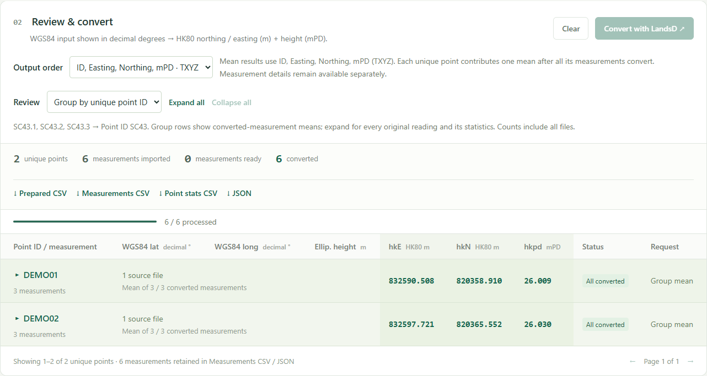

# GNSS → HK1980 coordinate converter

**By Anthony Wong · Version 1.1.0**

A local website for preparing GNSS exports, converting individual WGS84 readings with the Hong Kong Lands Department API, and exporting one mean coordinate per unique survey point for CAD.

**WGS84 latitude / longitude + ellipsoidal height → HK80 Easting / Northing + height in mPD.**



## Quick start

1. Extract the release ZIP and keep its folders together.
2. Use [Node.js](https://nodejs.org/) 22 or later. No package installation or build is needed.
3. On Windows, double-click **start.cmd**. Elsewhere, run `npm start` from this folder and open [the local website](http://127.0.0.1:8080).
4. Drag in TXT, CSV or TSV exports. Try [samples/demo_decimal.txt](samples/demo_decimal.txt): six synthetic readings of two unique points.
5. Click **Convert with LandsD**, then download **Results CSV** or **TXYZ TXT** in **Unique point means**.

Read the [user guide](docs/USER_GUIDE.md), or open the [printable HTML guide](docs/USER_GUIDE.html) in a browser. Opening `index.html` directly supports import, conversion and point overlays; use the launcher for the OSM background.

## Downloads

| Download         | Contents                                                                                                                                   |
| ---------------- | ------------------------------------------------------------------------------------------------------------------------------------------ |
| Results CSV      | Exactly `ID,Easting,Northing,mPD`; one mean row per fully converted unique point. Northing-first exports `ID,Northing,Easting,mPD`.        |
| TXYZ TXT         | `coordinate.txt`: the same unique means and IDs without a header or BOM. Default `ID,Easting,Northing,mPD` (TXYZ); Northing-first is TYXZ. |
| Measurements CSV | Every accepted reading, original/group/record IDs, source file/row, time, individual conversion results and errors.                        |
| Point stats CSV  | Counts, mean, sample SD, min/max and range per unique point; includes partial conversion counts.                                           |
| JSON             | Individual measurement data, named coordinate fields and provenance.                                                                       |
| Prepared CSV     | Four input fields: point name, normalized latitude, longitude and elevation.                                                               |

Example Results CSV:

```csv
ID,Easting,Northing,mPD
SC43,832590.508,820358.910,26.009
```

Equivalent headerless `coordinate.txt`:

```text
SC43,832590.508,820358.910,26.009
```

Means are calculated from individual LandsD results, then rounded to three decimal places. A point enters the four-column CAD exports only when **all its accepted readings have converted**. Incomplete groups remain in the detailed measurement/statistics exports; the interface shows the ready/incomplete counts.

## Features

- Multiple-file drag and drop; comma/tab/semicolon separators and quoted fields.
- Decimal/DMS checks and normalization; ambiguous packed DMS requires explicit selection.
- Hong Kong range checks, source-line errors and height-datum reminders.
- `SC43.1`, `.2`, `.3` collapse under point ID `SC43`; all measurements remain available.
- Unique point/measurement counts and converted mean/sample SD/min/max/range.
- OSM mini map, bounding rectangle and chronological playback with recorded times and delay control.
- EN/NE switching without reconversion; EN defaults to MicroStation TXYZ order.
- Responsive layout, larger type and keyboard controls.

Required columns: **Point name, Latitude, Longitude, Elevation**. Optional **Date** and **Time** drive playback. The app uses Elevation as WGS84 ellipsoidal height and ignores a separate Height column. Confirm the source datum; coordinate values alone cannot establish it.

## Data and services

Files and point names remain in the browser. OSM serves background tiles for the viewed area. Convert sends latitude, longitude and height to LandsD; a reading's Open link also requests conversion. State lasts for the current page session, so download before refreshing or closing.

The [official LandsD manual, Example 3](https://www.geodetic.gov.hk/transform/v2/tformAPI_manual.pdf#page=9) supplies the built-in reference check. Leaflet 1.9.4 and its BSD license are bundled; see [third-party notices](THIRD_PARTY_NOTICES.md).

## Development and sharing

```text
npm test
npm run test:live
npm run package
```

Offline tests need no network. The optional live check verifies the public LandsD reference response. Packaging writes a ZIP, SHA-256 checksum and manifest into `release/`. GitHub Actions checks Node.js 22 and 24. The source also works on a static host with relative asset paths.

See [CONTRIBUTING.md](CONTRIBUTING.md), [GitHub sharing](docs/GITHUB_SHARING.md) and [CHANGELOG.md](CHANGELOG.md). Release archives contain synthetic examples, not original field exports or generated survey results. The package does not choose a license for Anthony Wong's original application code.
