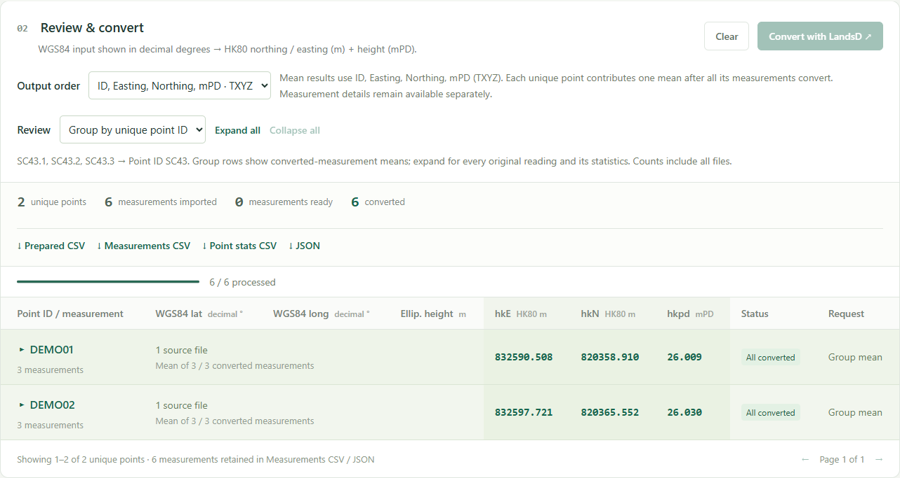

# GNSS → HK1980 coordinate converter

**By Anthony Wong · Version 1.1.0**

A local website for preparing GNSS exports, converting individual WGS84 readings with the Hong Kong Lands Department API, and exporting one mean coordinate per unique survey point for CAD.

**WGS84 latitude / longitude + ellipsoidal height → HK80 Easting / Northing + height in mPD.**



## Quick start

1. Extract the release ZIP and keep its folders together.
2. Use [Node.js](https://nodejs.org/) 22 or later. No package installation or build is needed.
3. On Windows, double-click **start.cmd**. Elsewhere, run `npm start` from this folder and open [the local website](http://127.0.0.1:8080).
4. Drag in TXT, CSV or TSV exports. Try [samples/demo_decimal.txt](samples/demo_decimal.txt): six synthetic readings of two unique points.
5. Click **Convert with LandsD**, then download **Results CSV** or **TXYZ TXT** in **Unique point means**.

Read the [user guide](docs/USER_GUIDE.md), or open the [printable HTML guide](docs/USER_GUIDE.html) in a browser. Opening `index.html` directly supports import, conversion and point overlays; use the launcher for the OSM background.

### Paste HK1980 points onto the map

Select **Paste coordinates**, type or paste coordinates, then click **Load & zoom to points**. You can also drop a TXT/CSV/TSV file into the writable text box. With headings, column order is detected: both `ID,Easting,Northing,mPD` (the website's default Results CSV) and `ID,Northing,Easting,Height` work. `Name`/`ID` and `Z`/`mPD`/`Height`/`Elevation` are accepted. **Without a header, the default is ID,Easting,Northing,mPD (TXYZ).** Use the **Column order without a header** selector for Northing-first rows. Headings always override this selector. Both numeric orders can pass HK80 range checks, so the app does not guess from the values. Commas, tabs, spaces and semicolons are supported. Try [samples/demo_nez.txt](samples/demo_nez.txt).

```text
Name,N,E,Z
P1,820358.910,832590.508,26.009
P2,820458.910,832690.508,27.000
```

These inputs are **HK1980 Grid coordinates in metres**, with Z retained in mPD. LandsD converts N/E to WGS84 map positions; Z is kept as entered. Internet access is required. Pasted points appear in blue alongside green GNSS readings. Loading replaces the previous pasted set and zooms to that set; **Fit all points** includes both. Invalid rows or failed/stopped lookups keep the previous set in place. The separate **Clear pasted points** button removes only the pasted set. GNSS conversion downloads and mean calculations continue to use receiver readings only.

You can drop a headed grid CSV onto the **main file import area** too: its headings identify existing HK80 points, its coordinates are checked against HK80 grid ranges, and the points are loaded directly onto the map. Mixed receiver/grid batches are supported. Existing N/E/Z are retained; grid CSVs are never sent through WGS84-to-HK80 conversion. Receiver exports with geographical fields keep their original import mapping, including Topcon's `84H` height field.

### Using a Git clone

Launch `start.cmd` or `npm start` from the repository root. Keep `vendor/leaflet/` beside the root `index.html`: it supplies the local map script and stylesheet. The `docs/`, `samples/`, `scripts/` and `tests/` folders also belong at that root. The `web_point_convert_visual/` copy includes the same Topcon/Sino import support and can also be launched from its own folder. The repository root is the main source for future edits.

The supported Topcon/Sino layout uses **Name, B, L, 84H**. Both website copies keep the same height checks, original measurement IDs and collection-time playback. See [GitHub Desktop instructions](docs/GITHUB_SHARING.md#commit-with-github-desktop) to commit local changes.

If the map library is missing, no OSM tile requests can start. Run `npm test` to check that the page assets exist and that Leaflet/converter load before the map/application scripts. Open the app through its local web address for OSM background tiles; direct `file://` mode shows observation overlays without requesting tiles.

## Downloads

| Download         | Contents                                                                                                                                   |
| ---------------- | ------------------------------------------------------------------------------------------------------------------------------------------ |
| Results CSV      | Exactly `ID,Easting,Northing,mPD`; one mean row per fully converted unique point. Northing-first exports `ID,Northing,Easting,mPD`.        |
| TXYZ TXT         | `<import-name>_converted.txt`: unique means and IDs without a header or BOM. Default `ID,Easting,Northing,mPD` (TXYZ); NE is TYXZ.           |
| Measurements CSV | Every accepted reading, original/group/record IDs, source file/row, time, individual results/errors, exclusion flags and reasons.             |
| Point stats CSV  | All-reading statistics plus retained counts, mean and sample SD per unique point; includes partial conversion counts.                       |
| JSON             | Individual measurements, coordinates, provenance and exclusion flags/reasons, including excluded readings.                                 |
| Prepared CSV     | Exactly `ID,Latitude,Longitude,Height`; original measurement names, normalized WGS84 decimal degrees and ellipsoidal height in metres.       |
| Prepared TXT     | The same four prepared fields and header, comma-separated, without a BOM.                                                                  |
| Spreadsheet layout CSV | Selected point's N/E/mPD readings, first-five-row retained statistics, remarks and original measurement names in ten columns.        |

Example Results CSV:

```csv
ID,Easting,Northing,mPD
SC43,832590.508,820358.910,26.009
```

Equivalent headerless converted TXT:

```text
SC43,832590.508,820358.910,26.009
```

Means are calculated from individual LandsD results, then rounded to three decimal places. A point enters the four-column CAD exports only when **all its accepted readings have converted**. Incomplete groups remain in the detailed measurement/statistics exports; the interface shows the ready/incomplete counts.

### Data analysis and selection

The analysis panel appears immediately before **MicroStation coordinate export**. Select a point ID (sorted naturally), then rank its converted readings by 3D, horizontal, height, Easting or Northing departure from the original group mean. Set **Measurements to keep**: for 200 readings, entering **180** makes **Preselect top 20 outliers** tick the 20 largest departures. The default target keeps 90%, rounded up, but nothing is excluded until you preselect or tick a checkbox.

Review the highlighted rows and the right-hand **Remove from mean** checkboxes. The comparison table shows original versus retained means and sample SD (`n − 1`) for E/N/mPD. Manual adjustments update Results CSV and TXYZ/TYXZ immediately. Each point has its own selection, across all analysis pages. **Restore all for this point** reverses that point's exclusions. At least two readings are retained when available; all readings must convert before selection is enabled.

Ranking stays relative to the full original group while exclusions are reviewed, so rows do not jump as you tick them. Equal departures keep import order; the interface identifies ties at the removal cutoff. These are review suggestions, not proof of faulty observations or a guarantee of the most accurate mean. Check field notes as well as SD. The raw review table and map keep all imported readings; detailed CSV/JSON keep excluded records and their reasons. Pasted HK80 map points do not enter receiver analysis.

**Spreadsheet layout CSV** exports the selected point for a ten-column survey worksheet: A point ID, B Northing, C Easting, D height (mPD), E statistic label, F/G/H statistic values for N/E/height, I remark, J original measurement name. Average, Max, Min, Max–Min and sample SD occupy the first five data rows in E–H, using retained readings only. Retained observations come first in original order, then excluded observations marked in Remark. Every original name is retained. Short groups are padded to five rows so no statistic is lost. The layout always uses Northing before Easting, independently of the MicroStation output selector. Open in Excel and copy the data rows (without the header) into an unmerged ten-column range. CSV carries values, not colours, strikethrough or merged cells.

### Export file names

The original import name is preserved without its extension. For `20261106_Topcon.txt`:

- Prepared CSV / TXT: `20261106_Topcon_reduced.csv` / `.txt`.
- Transformed mean CSV / TXT: `20261106_Topcon_converted.csv` / `.txt`.
- Spreadsheet layout: `20261106_Topcon_converted_spreadsheet.csv`.
- Detailed measurements, statistics and JSON add `_measurements` or `_statistics` after `_converted`.

Multiple source names are combined for a combined export; very long names are shortened. The reference example uses `manual_example`. The page displays the file names beside the output controls, and download button tooltips show their names.

Prepared CSV uses `ID,Latitude,Longitude,Height` for upload to the [LandsD coordinate converter](https://www.geodetic.gov.hk/en/services/tform/tform.aspx), linked beside its download button. Height contains the original WGS84 ellipsoidal height, with full source precision retained. This four-column format can also be reimported here.

## Features

- Multiple-file drag and drop; comma/tab/semicolon separators and quoted fields.
- Decimal/DMS checks and normalization; ambiguous packed DMS requires explicit selection.
- Hong Kong range checks, source-line errors and height-datum reminders.
- `SC43.1`, `.2`, `.3` collapse under point ID `SC43`; all measurements remain available.
- Unique point/measurement counts and converted mean/sample SD/min/max/range.
- OSM mini map, bounding rectangle and chronological playback with recorded times and delay control.
- Small, Medium, Large and Full screen map controls; hover over GNSS or pasted points in Large/Full screen to read their names.
- EN/NE switching without reconversion; EN defaults to MicroStation TXYZ order.
- Responsive layout, larger type and keyboard controls.

Receiver layouts are detected from column headings; column order is flexible:

| Layout | Point name | Latitude | Longitude | WGS84 ellipsoidal height | Collection time |
| --- | --- | --- | --- | --- | --- |
| Standard export | Point name | Latitude | Longitude | Elevation | Date + Time (optional) |
| Topcon export | Name | B | L | 84H | Start time (optional), e.g. `2026/10/16 09:32:30` |

**Topcon's Elevation column is ignored; height comes only from 84H.** Existing E/N/Z and a standard export's separate Height are also ignored. Missing or ambiguous required headings are rejected. The file list shows the detected mapping. Topcon timestamps drive chronological playback across files; the original timestamp is retained in Measurements CSV/JSON. Invalid or missing timestamps use the existing import-order playback fallback.

Topcon readings retain their full decimal precision. `2098.010.1` and `2098.010.2` group under **2098.010**, and duplicate names remain separate readings with separate Record IDs. Try [samples/demo_topcon.txt](samples/demo_topcon.txt) for a synthetic example. Both receiver layouts can be imported together. Confirm the source datum; coordinate values alone cannot establish it.

## Data and services

Files and point names remain in the browser. OSM serves background tiles for the viewed area. Convert sends latitude, longitude and height to LandsD; a reading's Open link also requests conversion. State lasts for the current page session, so download before refreshing or closing.

The [official LandsD manual, Example 3](https://www.geodetic.gov.hk/transform/v2/tformAPI_manual.pdf#page=9) supplies the built-in reference check. Leaflet 1.9.4 and its BSD license are bundled; see [third-party notices](THIRD_PARTY_NOTICES.md).

## Development and sharing

```text
npm test
npm run test:live
npm run package
```

Offline tests need no network. The optional live check verifies the public LandsD reference response. Packaging writes a ZIP, SHA-256 checksum and manifest into `release/`. GitHub Actions checks Node.js 22 and 24. The source also works on a static host with relative asset paths.

See [CONTRIBUTING.md](CONTRIBUTING.md), [GitHub sharing](docs/GITHUB_SHARING.md) and [CHANGELOG.md](CHANGELOG.md). Release archives contain synthetic examples, not original field exports or generated survey results. The package does not choose a license for Anthony Wong's original application code.
