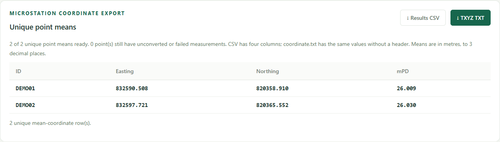

# User guide

**GNSS → HK1980 coordinate converter · Anthony Wong · v1.1.0**

From receiver TXT exports to unique-point mean coordinates for MicroStation.

## 1. Open the website

Extract the ZIP first. On Windows, double-click `start.cmd` and keep its server window open. It opens `http://127.0.0.1:8080`. Use Node.js 22 or later; no package installation is needed. On macOS/Linux, run `npm start` in the extracted folder and visit the same address.

Opening `index.html` directly supports import, conversion and point overlays. Use the local server for the OSM background. If port 8080 is busy, stop your earlier server or set a different `PORT` before running `node server.js`.

## 2. Check the conversion direction

**Input:** WGS84 latitude, longitude and ellipsoidal height in metres.

**Output:** HK80 / HK1980 Grid Easting and Northing, plus height in metres above Hong Kong Principal Datum (**mPD**).

Standard exports use `Elevation` for ellipsoidal height and ignore a separate `Height` field. Topcon exports use `84H` for ellipsoidal height and ignore `Elevation` and existing `E`, `N`, `Z` coordinates. Confirm the receiver's height datum: existing mPD/orthometric height must not be supplied as ellipsoidal height. Coordinate values alone cannot identify their datum.

## 3. Choose a format and import

Drag in `.txt`, `.csv` or `.tsv` files, or click Browse. Column order is flexible and the file list shows the detected receiver mapping:

- **Standard exports:** `Point name`, `Latitude`, `Longitude`, `Elevation`. Optional `Date` and `Time` drive playback.
- **Topcon exports:** `Name`, `B` (latitude), `L` (longitude), `84H` (WGS84 ellipsoidal height). Optional `Start time`, such as `2026/10/16 09:32:30`, is split into date and time for playback. Do not rename Topcon's `Elevation` to a height field. Missing `84H` is rejected instead of substituting `Elevation` or `Z`.

You can mix files from both receivers in the same import. Topcon's decimal precision and original timestamps are retained. Invalid or missing timestamps preserve the readings and switch playback to import order, with a notice.

- **Auto:** plain numbers are decimal degrees. Separated DMS such as `22°19′20.064″`, `22 19 20.064` or `22:19:20.064` is normalized locally.
- **Decimal degrees:** decimal angles only; separated DMS is rejected.
- **DMS:** complete degrees, minutes and seconds are required.
- **Packed DMS:** explicitly interprets `22.1920064` as `22°19′20.064″`. Auto cannot distinguish that number from a decimal-degree angle, so select this mode yourself.

N/S and E/W markers can prefix or suffix angles. Minutes/seconds must be below 60. Wrong hemisphere letters, contradictory signs, incomplete angles and coordinates outside Hong Kong are rejected with file/line details. A format change applies to later imports; clear and reimport to reinterpret existing data.

Supported separators are comma, tab and semicolon. UTF-8 and UTF-16 with a byte-order mark work. Each file is limited to 20 MB. Accepted ranges: latitude 22.13–22.57°, longitude 113.82–114.48°, elevation −1000–10000 m. Importing a file again adds its readings again.

Try `samples/demo_decimal.txt` (six synthetic readings of two points), `samples/demo_dms.txt` (two DMS forms of the public manual example), or `samples/demo_topcon.txt` (Topcon headings, timestamps and repeated names). These are demonstrations, not field measurements.

## 4. Review groups and counts

### Paste HK1980 grid points directly

In **Add your files**, choose the **Paste coordinates** tab to open the writable input box. Paste or type one point per line, or drag a TXT/CSV/TSV file into the box:

```text
Name,N,E,Z
P1,820358.910,832590.508,26.009
P2,820458.910,832690.508,27.000
```

The header is optional. **Without a header, the default is ID, Easting, Northing, mPD**, matching TXYZ output. For Northing-first rows, select **ID, Northing, Easting, mPD** in **Column order without a header**, then load again. Both orders can fit the HK80 numeric ranges, so numbers alone cannot establish the order. With headings, either EN or NE order works and headings override the selector: `ID,Easting,Northing,mPD`, `ID,Northing,Easting,Height` and the website's own Results CSVs are accepted. Point headings can be `Name` or `ID`; height headings can be `Z`, `mPD`, `Height` or `Elevation`. Headings are case-insensitive and may be reordered. Duplicate coordinate headings are rejected as ambiguous. All coordinates are metres in HK1980 Grid and Z is kept in mPD. Commas, spreadsheet tabs, spaces and semicolons work. For names containing spaces, use comma/tab separated rows; CSV names containing commas must be quoted.

You can also drop a headed grid CSV onto the main **GNSS files** import area. The app identifies grid headings, checks HK80 Northing/Easting ranges, switches to the point input tab and plots the points. Existing HK80 N/E/Z are preserved. The only lookup derives the OSM map location; these rows are not converted from WGS84 back to HK80. You can import receiver files and grid CSVs in the same batch.

Click **Load & zoom to points**. LandsD locates N/E for the OSM map; your names and Z values stay in the browser. The map shows these points in blue and zooms to their area. Internet access is required. Clicking a point displays its original N/E/Z and name. Try `samples/demo_nez.txt`.

Loading a new set replaces the previous pasted set. Invalid rows, failed requests or **Stop** preserve the earlier set; correct the listed rows or retry. **Clear pasted points** removes only this set. Receiver readings remain visible in green; **Fit all points** includes both sets. Pasted points stay separate from receiver statistics and conversion downloads.

### Review receiver measurements

`SC43.1`, `SC43.2`, `SC43.3` share unique point ID **SC43**. Only a final dot followed by digits is removed; IDs are case-sensitive. `AREA.SC43.003` becomes point `AREA.SC43`, measurement index `003`.

The page distinguishes unique points from imported measurements. Expand a point, use Expand all / Collapse all, or select All measurements. Same-named readings, including duplicates within one file, are retained separately. For example, `2098.010.1` and `2098.010.2` belong to **2098.010**. Measurements CSV/JSON preserves each original name, group ID, unique Record ID, source file/line, receiver format and recorded time, including Topcon's original timestamp.

## 5. Map and collection playback

The map shows every accepted measurement and the full bounding rectangle, across all table pages. Fit all points restores the survey extent. Rejected rows are excluded.

Use **Map size** to select **Small**, **Medium** (default), **Large** or **Full screen**. Resizing keeps the current view and playback state. Full screen has an **Exit full screen** button; Escape also exits, restoring the previous size. If browser full screen is unavailable, the map fills the browser window instead.

In **Large** and **Full screen**, hover over a point to see its original point name in a tooltip. This works for both green GNSS readings and blue pasted points, including readings revealed during playback. Clicking a point still opens its details.

Play collection reveals readings one by one. Adjust the delay, pause/resume, replay or Show all points. The orange ring highlights the current reading; the readout gives its original name and collection time.

When every reading has valid Date (`YYYY-MM-DD`) and Time (`HH:mm:ss`, optionally fractional seconds), playback sorts across all files by collection time. Equal timestamps keep import order. Otherwise the app explicitly uses file/import order. No missing dates are inferred or timezones converted. Delay is fixed per reading and does not reproduce actual time gaps.

## 6. Convert all measurements

Click Convert with LandsD. The app makes two requests at a time; an individual request times out after 30 seconds. Stop conversion retains completed results. Convert remaining resumes or retries pending/failed readings.

Each reading is converted individually before averaging. Expand a group to see mean, sample standard deviation, min/max and range of completed results. Sample SD uses `n − 1` and is unavailable for a single reading. Partial statistics display used/total counts.

## 7. Analyze and select measurements

The **Data analysis and selection** panel appears before **MicroStation coordinate export**. Use it after converting the receiver readings.

1. Select a **Point ID**. IDs are sorted naturally (for example, P2 before P10); each point's readings are analyzed separately.
2. Choose **Rank outliers by**: 3D distance, horizontal distance, height deviation, Easting or Northing. The largest departures from the original group mean come first, in metres. Coordinate cells also show each reading's signed departure (Δ).
3. Set **Measurements to keep**. For 200 readings, enter **180**, then click **Preselect top 20 outliers**. The suggested target is 90%, rounded up; entering a target does not itself exclude any readings.
4. Review the highlighted rows. A tick in the right-hand **Remove from mean** column excludes that individual record. Untick to restore it. Duplicate measurement names have separate record IDs and can be selected independently.
5. Compare **All readings mean / SD** with **Retained mean / SD** for E, N and mPD. Then download the mean CSV or TXYZ below; the exports use your retained readings.

All measurements for the selected point must convert before exclusions can be edited. At least two readings must be retained when two or more are available, so sample SD remains defined. A single-reading point has a mean but no sample SD. Selections cover every page (50 ranked readings per page) and stay independent for each point. Changing the ranking metric preserves existing exclusions; preselect again to replace them with that metric's suggestions. **Restore all for this point** reverses its selections.

Ranking remains based on all original converted readings while you review; it does not shift as you tick boxes. Equal scores keep import order; ties at the cutoff are identified. Lower SD describes a tighter cluster and does not by itself establish accuracy. Review field notes before removing readings. The original review table and map retain all observations, and Measurements CSV/JSON retain excluded records, their unique IDs and reasons. Point stats CSV includes both original statistics and retained mean/SD/counts. Pasted grid points remain separate from this receiver analysis.

### Export a spreadsheet worksheet layout

Choose a point, review its exclusions, then click **Spreadsheet layout CSV** in the analysis panel. It exports that point's readings with statistics in the first five data rows, matching the ten-column survey worksheet arrangement:

- **A:** unique point ID, on the first row of the block.
- **B/C/D:** each observation's Northing, Easting and height in mPD.
- **E:** Average, Max, Min, Max–Min and sample SD, in the first five data rows.
- **F/G/H:** those statistics for Northing, Easting and height, calculated from retained observations only.
- **I:** exclusion remark for removed readings.
- **J:** original measurement name for every observation.

Retained observations come first in their original order, followed by excluded observations. The sheet always uses N/E/mPD order, even if MicroStation output is EN. All measurements for the selected point must convert first. Groups with fewer than five readings are padded to keep all five statistics; a single reading has no sample SD. Coordinates and statistics are shown to three decimals.

Open the CSV in Excel, select the ten data columns below its header, and paste into an unmerged A2:J… area of your template. Apply the template's colours and merges afterward; CSV contains values rather than formatting. Excluded observations remain in the CSV with a remark.

## 8. Download unique-point mean CSV

Use the separate **Unique point means** panel. A group enters this export only after **all its accepted measurements convert**. Its exported mean uses the readings retained in **Data analysis and selection**. Incomplete groups remain in the measurement/statistics downloads, and the panel shows ready/incomplete counts.

The default Results CSV has exactly four columns and one mean row per eligible ID:

```csv
ID,Easting,Northing,mPD
SC43,832590.508,820358.910,26.009
```

Choose ID, Northing, Easting, mPD to swap the horizontal fields. Table and download values follow immediately without reconversion. Means are rounded to three decimals after averaging individual LandsD results.



## 9. Create the converted TXT for TXYZ

After conversion, click **TXYZ TXT**. The app directly downloads `<original-import-name>_converted.txt` without a header or BOM:

```text
SC43,832590.508,820358.910,26.009
```

**T** is unique point ID, **X** is mean Easting, **Y** is mean Northing and **Z** is mean mPD height. Fields are comma-separated and coordinates are in metres. Use a matching text-coordinate layout and comma delimiter in MicroStation. Bentley's [coordinate-import guidance](https://bentleysystems.service-now.com/community?id=kb_article_view&sysparm_article=KB0110853) describes its XYZ Text / Import Coordinates workflow; labels/options vary by installed version.

With Northing-first selected, the button reads **TYXZ TXT**, and the row is `ID,Northing,Easting,mPD`. Match that Y/X order in the importer. TXT export rejects IDs containing commas, quotes or line breaks; Results CSV supports quoted IDs.

## Other downloads

- **Measurements CSV:** all readings, point/record IDs, source, time, individual coordinates/errors, exclusion flags and reasons.
- **Point stats CSV:** one row per ID; original counts/mean/sample SD/min/max/range plus retained counts/mean/SD. Includes partial groups for analysis.
- **JSON:** individual readings with named coordinates, provenance and exclusion flags/reasons; excluded observations are retained.
- **Prepared CSV:** exactly `ID,Latitude,Longitude,Height`, with original measurement IDs, DMS normalized to decimal degrees, and WGS84 ellipsoidal height in metres. Input precision is retained. The **LandsD coordinate converter** link beside this download opens [the government transformation tool](https://www.geodetic.gov.hk/en/services/tform/tform.aspx) in a new tab. You can also reimport this four-column format into this website.
- **Prepared TXT:** the same four fields and header as Prepared CSV, comma-separated, without a BOM.

File names keep the original import name, with `_reduced` for prepared files and `_converted` for transformed results. For example, `20261106_Topcon.txt` produces `20261106_Topcon_reduced.csv` or `.txt`, and `20261106_Topcon_converted.csv` or `.txt`. The spreadsheet layout adds `_spreadsheet`; detailed measurements and statistics add `_measurements` or `_statistics` after `_converted`. Multiple input names are combined for combined downloads; very long names are shortened. The manual example uses `manual_example`. Check the displayed file-name note or download-button tooltip before downloading.

Downloads include all applicable files/pages, independent of which groups are expanded. Save before refreshing or closing: the workspace is not stored permanently.

## Troubleshooting

- **No mean rows:** finish/retry every reading for the point. Partially converted groups stay out of the four-column CAD exports.
- **Wrong angle format:** choose the right mode, clear and reimport. Packed DMS is never guessed.
- **Blank background:** use `start.cmd` or the local server and check internet access. Point overlays/bounds still work without tiles.
- **API error:** inspect the reading's message, retry, or open its government request.
- **Playback seems stationary:** repeated readings may be millimetres apart. Watch the time/counter or zoom in.
- **Port busy:** stop an earlier local server or choose a different `PORT`.

## Reference check

Load manual example, then convert. [LandsD Example 3](https://www.geodetic.gov.hk/transform/v2/tformAPI_manual.pdf#page=9) uses latitude `22.32224`, longitude `114.14118`, height `23.128`:

```json
{ "hkN": 820358.91, "hkE": 832590.508, "hkpd": 26.009 }
```

The app checks the live response; it never inserts expected values after a network failure.
