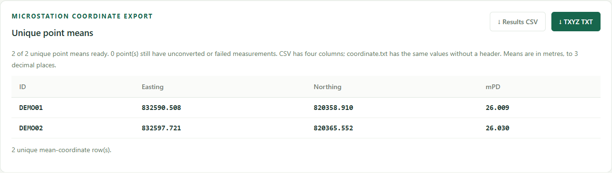

# User guide

**GNSS → HK1980 coordinate converter · Anthony Wong · v1.1.0**

From receiver TXT exports to unique-point mean coordinates for MicroStation.

## 1. Open the website

Extract the ZIP first. On Windows, double-click `start.cmd` and keep its server window open. It opens `http://127.0.0.1:8080`. Use Node.js 22 or later; no package installation is needed. On macOS/Linux, run `npm start` in the extracted folder and visit the same address.

Opening `index.html` directly supports import, conversion and point overlays. Use the local server for the OSM background. If port 8080 is busy, stop your earlier server or set a different `PORT` before running `node server.js`.

## 2. Check the conversion direction

**Input:** WGS84 latitude, longitude and ellipsoidal height in metres.

**Output:** HK80 / HK1980 Grid Easting and Northing, plus height in metres above Hong Kong Principal Datum (**mPD**).

Standard exports use `Elevation` for ellipsoidal height and ignore a separate `Height` field. Topcon exports use `84H` for ellipsoidal height and ignore `Elevation` and existing `E`, `N`, `Z` coordinates. Confirm the receiver's height datum: existing mPD/orthometric height must not be supplied as ellipsoidal height. Coordinate values alone cannot identify their datum.

## 3. Choose a format and import

Drag in `.txt`, `.csv` or `.tsv` files, or click Browse. Column order is flexible and the file list shows the detected receiver mapping:

- **Standard exports:** `Point name`, `Latitude`, `Longitude`, `Elevation`. Optional `Date` and `Time` drive playback.
- **Topcon exports:** `Name`, `B` (latitude), `L` (longitude), `84H` (WGS84 ellipsoidal height). Optional `Start time`, such as `2026/10/16 09:32:30`, is split into date and time for playback. Do not rename Topcon's `Elevation` to a height field. Missing `84H` is rejected instead of substituting `Elevation` or `Z`.

You can mix files from both receivers in the same import. Topcon's decimal precision and original timestamps are retained. Invalid or missing timestamps preserve the readings and switch playback to import order, with a notice.

- **Auto:** plain numbers are decimal degrees. Separated DMS such as `22°19′20.064″`, `22 19 20.064` or `22:19:20.064` is normalized locally.
- **Decimal degrees:** decimal angles only; separated DMS is rejected.
- **DMS:** complete degrees, minutes and seconds are required.
- **Packed DMS:** explicitly interprets `22.1920064` as `22°19′20.064″`. Auto cannot distinguish that number from a decimal-degree angle, so select this mode yourself.

N/S and E/W markers can prefix or suffix angles. Minutes/seconds must be below 60. Wrong hemisphere letters, contradictory signs, incomplete angles and coordinates outside Hong Kong are rejected with file/line details. A format change applies to later imports; clear and reimport to reinterpret existing data.

Supported separators are comma, tab and semicolon. UTF-8 and UTF-16 with a byte-order mark work. Each file is limited to 20 MB. Accepted ranges: latitude 22.13–22.57°, longitude 113.82–114.48°, elevation −1000–10000 m. Importing a file again adds its readings again.

Try `samples/demo_decimal.txt` (six synthetic readings of two points), `samples/demo_dms.txt` (two DMS forms of the public manual example), or `samples/demo_topcon.txt` (Topcon headings, timestamps and repeated names). These are demonstrations, not field measurements.

## 4. Review groups and counts

`SC43.1`, `SC43.2`, `SC43.3` share unique point ID **SC43**. Only a final dot followed by digits is removed; IDs are case-sensitive. `AREA.SC43.003` becomes point `AREA.SC43`, measurement index `003`.

The page distinguishes unique points from imported measurements. Expand a point, use Expand all / Collapse all, or select All measurements. Same-named readings, including duplicates within one file, are retained separately. For example, `2098.010.1` and `2098.010.2` belong to **2098.010**. Measurements CSV/JSON preserves each original name, group ID, unique Record ID, source file/line, receiver format and recorded time, including Topcon's original timestamp.

## 5. Map and collection playback

The map shows every accepted measurement and the full bounding rectangle, across all table pages. Fit all points restores the survey extent. Rejected rows are excluded.

Play collection reveals readings one by one. Adjust the delay, pause/resume, replay or Show all points. The orange ring highlights the current reading; the readout gives its original name and collection time.

When every reading has valid Date (`YYYY-MM-DD`) and Time (`HH:mm:ss`, optionally fractional seconds), playback sorts across all files by collection time. Equal timestamps keep import order. Otherwise the app explicitly uses file/import order. No missing dates are inferred or timezones converted. Delay is fixed per reading and does not reproduce actual time gaps.

## 6. Convert all measurements

Click Convert with LandsD. The app makes two requests at a time; an individual request times out after 30 seconds. Stop conversion retains completed results. Convert remaining resumes or retries pending/failed readings.

Each reading is converted individually before averaging. Expand a group to see mean, sample standard deviation, min/max and range of completed results. Sample SD uses `n − 1` and is unavailable for a single reading. Partial statistics display used/total counts.

## 7. Download unique-point mean CSV

Use the separate **Unique point means** panel. A group enters this export only after **all its accepted measurements convert**. Incomplete groups remain in the measurement/statistics downloads, and the panel shows ready/incomplete counts.

The default Results CSV has exactly four columns and one mean row per eligible ID:

```csv
ID,Easting,Northing,mPD
SC43,832590.508,820358.910,26.009
```

Choose ID, Northing, Easting, mPD to swap the horizontal fields. Table and download values follow immediately without reconversion. Means are rounded to three decimals after averaging individual LandsD results.



## 8. Create coordinate.txt for TXYZ

After conversion, click **TXYZ TXT**. The app directly downloads `coordinate.txt` without a header or BOM:

```text
SC43,832590.508,820358.910,26.009
```

**T** is unique point ID, **X** is mean Easting, **Y** is mean Northing and **Z** is mean mPD height. Fields are comma-separated and coordinates are in metres. Use a matching text-coordinate layout and comma delimiter in MicroStation. Bentley's [coordinate-import guidance](https://bentleysystems.service-now.com/community?id=kb_article_view&sysparm_article=KB0110853) describes its XYZ Text / Import Coordinates workflow; labels/options vary by installed version.

With Northing-first selected, the button reads **TYXZ TXT**, and the row is `ID,Northing,Easting,mPD`. Match that Y/X order in the importer. TXT export rejects IDs containing commas, quotes or line breaks; Results CSV supports quoted IDs.

## Other downloads

- **Measurements CSV:** all readings, point/record IDs, source, time, individual coordinates and errors.
- **Point stats CSV:** one row per ID; counts, mean, sample SD, min/max and range. Includes partial groups for analysis.
- **JSON:** individual readings with named coordinates and provenance.
- **Prepared CSV:** four cleaned WGS84 fields, with DMS normalized to decimal degrees.

Downloads include all applicable files/pages, independent of which groups are expanded. Save before refreshing or closing: the workspace is not stored permanently.

## Troubleshooting

- **No mean rows:** finish/retry every reading for the point. Partially converted groups stay out of the four-column CAD exports.
- **Wrong angle format:** choose the right mode, clear and reimport. Packed DMS is never guessed.
- **Blank background:** use `start.cmd` or the local server and check internet access. Point overlays/bounds still work without tiles.
- **API error:** inspect the reading's message, retry, or open its government request.
- **Playback seems stationary:** repeated readings may be millimetres apart. Watch the time/counter or zoom in.
- **Port busy:** stop an earlier local server or choose a different `PORT`.

## Reference check

Load manual example, then convert. [LandsD Example 3](https://www.geodetic.gov.hk/transform/v2/tformAPI_manual.pdf#page=9) uses latitude `22.32224`, longitude `114.14118`, height `23.128`:

```json
{ "hkN": 820358.91, "hkE": 832590.508, "hkpd": 26.009 }
```

The app checks the live response; it never inserts expected values after a network failure.
